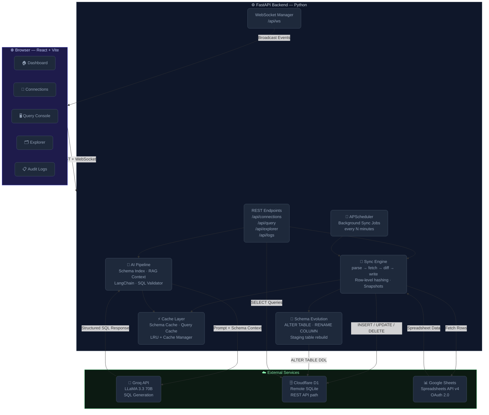

<div align="center">

# 🔗 Sheets → D1 SaaS Platform

### *Transform any Google Spreadsheet into a queryable, AI-powered SQL database — in seconds.*

[](https://python.org)
[](https://fastapi.tiangolo.com)
[](https://react.dev)
[](https://developers.cloudflare.com/d1/)
[](https://groq.com)
[](LICENSE)

<br/>

> **Paste a Google Sheets URL → watch it sync to Cloudflare D1 → ask questions in plain English → get SQL results instantly.**

<br/>


</div>

---

## 📖 Table of Contents

- [✨ What It Does](#-what-it-does)
- [🏗️ Architecture Overview](#️-architecture-overview)
- [⚡ Feature Highlights](#-feature-highlights)
- [🛠️ Tech Stack](#️-tech-stack)
- [📁 Project Structure](#-project-structure)
- [🚀 Getting Started](#-getting-started)
  - [Prerequisites](#prerequisites)
  - [1. Clone the Repository](#1-clone-the-repository)
  - [2. Backend Setup](#2-backend-setup)
  - [3. Frontend Setup](#3-frontend-setup)
  - [4. Configure Environment Variables](#4-configure-environment-variables)
  - [5. Google OAuth Setup](#5-google-oauth-setup)
  - [6. Cloudflare D1 Setup](#6-cloudflare-d1-setup)
  - [7. Run the Application](#7-run-the-application)
- [🔌 API Reference](#-api-reference)
- [🧠 How the AI Query Engine Works](#-how-the-ai-query-engine-works)
- [🔄 Sync Engine Deep Dive](#-sync-engine-deep-dive)
- [🗃️ Database Schema](#️-database-schema)
- [📊 Frontend Pages](#-frontend-pages)
- [⚙️ Configuration Reference](#️-configuration-reference)
- [🧪 Running Tests](#-running-tests)
- [🐛 Troubleshooting](#-troubleshooting)
- [🗺️ Roadmap](#️-roadmap)

---

## ✨ What It Does

**Sheets → D1** is a full-stack SaaS platform that bridges the gap between **Google Sheets** (the world's most popular spreadsheet) and **Cloudflare D1** (an edge-deployed SQLite database), powered by an **AI SQL assistant** built on LLaMA 3.3 via Groq.

### The Core Workflow

```
Google Sheet URL
      │
      ▼
  Parse + Validate URL
      │
      ▼
  Fetch via Google Sheets API
      │
      ▼
  Incremental Row-Level Sync ──────► Cloudflare D1 (SQLite)
      │                                     │
      ▼                                     ▼
  Schema Evolution (auto-migrate)    Table: {sheet}_{worksheet}
      │
      ▼
  User asks question in plain English
      │
      ▼
  LLM (LLaMA 3.3 / Groq) generates SQL
      │
      ▼
  SQL validated + executed against D1
      │
      ▼
  Results shown in React UI ← ← ← ← ← ─
```

### Why This Exists

| Problem | Solution |
|---------|---------|
| Google Sheets can't be queried with SQL | Sync to D1, a real SQLite database |
| LLMs can't directly access your spreadsheet data | Schema is indexed; LLM only sees structure, not raw data |
| Schema changes break pipelines | Auto-migration handles new columns, renames, type changes |
| Multiple spreadsheets create table collisions | Tables namespaced as `{spreadsheet}_{worksheet}` |
| Manual sync is error-prone | APScheduler runs incremental sync every N minutes |

---

## 🏗️ Architecture Overview



---

## ⚡ Feature Highlights

### 🔄 Intelligent Incremental Sync
- **Row-level hashing** — only changed rows are updated, never full table rebuilds
- **Primary key detection** — heuristically detects `id`, `uuid`, `key`, `email` columns for accurate matching
- **Soft deletes** — rows removed from the spreadsheet are marked `is_deleted = 1`, not physically deleted
- **Snapshot store** — `sheet_snapshots` table tracks every row's previous state for precise delta computation

### 🧠 AI-Powered Natural Language Queries
- Ask anything in plain English: *"What is the average price of items with stock above 50?"*
- **RAG-based schema retrieval** — only the relevant tables are injected into the LLM prompt
- **Structured output** — Pydantic-validated SQL response (no hallucinated markdown, no wrapping text)
- **AST validation** — generated SQL is parsed by `sqlglot` before execution
- **3-layer caching** — question cache → SQL cache → DB query (sub-millisecond repeated queries)
- **Sheet scoping** — optionally restrict the LLM to a single spreadsheet's schema

### 🏗️ Automatic Schema Evolution
- **New columns** → `ALTER TABLE ADD COLUMN` applied automatically
- **Renamed columns** → detected via edit-distance similarity, applied with `RENAME COLUMN`
- **Type changes** → staging table rebuild: `CREATE staging → INSERT CAST → DROP original → RENAME`
- **Missing metadata columns** → auto-added (`_row_index`, `_row_hash`, `is_deleted`, `deleted_at`)

### 🔒 Collision-Free Table Naming
All synced tables are namespaced as:
```
{sanitized_spreadsheet_name}_{sanitized_worksheet_title}
```
Example: `"Sales Data"` spreadsheet + `"Q1 2024"` worksheet → `sales_data_q1_2024`

### 📡 Real-time WebSocket Updates
- Connection status changes broadcast instantly to all connected browser tabs
- Schema cache auto-refreshed after every sync cycle
- Query cache invalidated on write operations

### 🛡️ Admin & Maintenance Tools
- **Cleanup Orphan Tables** — drops D1 tables belonging to disconnected sheets
- **Schema Cache Refresh** — manual trigger without server restart
- **Force Sync** — trigger immediate sync for any connection from the UI

---

## 🛠️ Tech Stack

| Layer | Technology | Purpose |
|-------|-----------|---------|
| **Frontend** | React 18 + TypeScript | Single-page application |
| **Build Tool** | Vite | Fast HMR development server |
| **UI Styling** | Tailwind CSS | Dark glassmorphism design |
| **State Management** | TanStack Query v5 | Server state, caching, mutations |
| **Tables** | TanStack Table v8 | Headless table rendering |
| **Real-time** | WebSocket (native) | Live sync status updates |
| **Backend** | FastAPI | Async Python REST API |
| **ASGI Server** | Uvicorn | Production-ready ASGI runtime |
| **Database** | Cloudflare D1 | Edge-deployed SQLite |
| **DB Client** | Custom REST client + Wrangler fallback | D1 HTTP API / CLI |
| **ORM** | SQLAlchemy | Local metadata management |
| **Spreadsheets** | gspread + Google Auth | Google Sheets API v4 |
| **LLM** | LangChain + Groq (LLaMA 3.3 70B) | SQL generation |
| **SQL Validation** | sqlglot | AST-level query validation |
| **Scheduling** | APScheduler | Background sync jobs |
| **Data Processing** | pandas | DataFrame operations |
| **Testing** | pytest | Unit & integration tests |

---

## 📁 Project Structure

```
google-sheets-assistant/
│
├── app.py                          # FastAPI application, all REST endpoints
├── config.py                       # Centralized environment config
├── requirements.txt                # Python dependencies (pinned)
├── .env.example                    # Environment variable template
│
├── services/
│   ├── sync_engine.py              # Core sync: parse, fetch, diff, write
│   ├── d1_http_client.py           # Cloudflare D1 REST API client
│   ├── scheduler.py                # APScheduler job management
│   ├── sheets_client.py            # Google Sheets metadata fetcher
│   ├── google_auth.py              # OAuth2 authentication flow
│   ├── llm.py                      # LangChain + Groq LLM initialization
│   ├── websocket_manager.py        # WebSocket broadcast manager
│   └── retry.py                    # Async retry decorator
│
├── retrieval/
│   ├── prompt_builder.py           # Schema context composer for LLM
│   ├── schema_index.py             # In-memory schema index
│   └── schema_search.py            # Relevance-based table selector
│
├── cache/
│   ├── schema_cache.py             # Database schema cache (refreshed on sync)
│   ├── query_cache.py              # LRU query result cache
│   └── cache_manager.py            # Cache invalidation coordinator
│
├── validation/
│   └── sql_validator.py            # sqlglot AST-based SQL validator
│
├── schema/
│   ├── type_inferrer.py            # Pandas dtype → SQLite type mapping
│   └── schema_builder.py           # Build CREATE TABLE + INSERT SQL
│
├── sync/
│   ├── schema_diff.py              # Diff two schemas: added/renamed/type-changed
│   └── migration_engine.py         # Generate ALTER TABLE DDL from diffs
│
├── db/
│   ├── database.py                 # SQLAlchemy engine + D1 gateway setup
│   └── models.py                   # SQLAlchemy ORM models
│
├── monitoring/
│   ├── logger.py                   # Structured JSON logger
│   └── metrics.py                  # Performance metric context managers
│
├── exceptions/
│   ├── d1_exceptions.py            # D1-specific exception classes
│   ├── sync_exceptions.py          # Sync pipeline exceptions
│   └── llm_exceptions.py           # LLM output exceptions
│
├── approval/
│   ├── approval_service.py         # Legacy approval service (deprecated)
│   └── approval_queue.py           # Legacy approval queue (deprecated)
│
├── data/                           # Runtime JSON state files (gitignored)
├── logs/                           # Application logs (gitignored)
├── tests/                          # pytest test suite
│
└── frontend/
    ├── src/
    │   ├── App.tsx                 # Root app with sidebar navigation
    │   ├── pages/
    │   │   ├── Dashboard.tsx       # System overview + recent logs
    │   │   ├── Connections.tsx     # Sheet registration & management
    │   │   ├── Query.tsx           # NLP SQL assistant console
    │   │   ├── Explorer.tsx        # Live database table browser
    │   │   └── Logs.tsx            # Sync audit log viewer
    │   └── hooks/
    │       └── useWebSocket.ts     # WebSocket hook for live updates
    ├── package.json
    └── vite.config.ts
```

---

## 🚀 Getting Started

### Prerequisites

| Requirement | Version | Notes |
|------------|---------|-------|
| Python | 3.11+ | Tested on 3.12 / 3.14 |
| Node.js | 18+ | For frontend build |
| npm | 9+ | Package manager |
| Wrangler CLI | 4+ | `npm install -g wrangler` |
| Cloudflare Account | — | Free tier is sufficient |
| Google Cloud Project | — | For Sheets API OAuth |
| Groq API Key | — | Free at console.groq.com |

---

### 1. Clone the Repository

```bash
git clone https://github.com/your-org/google-sheets-assistant.git
cd google-sheets-assistant
```

---

### 2. Backend Setup

```bash
# Create and activate virtual environment
python -m venv venv

# Windows
venv\Scripts\activate

# macOS / Linux
source venv/bin/activate

# Install dependencies
pip install -r requirements.txt
```

---

### 3. Frontend Setup

```bash
cd frontend
npm install
cd ..
```

---

### 4. Configure Environment Variables

Copy the example file and fill in your credentials:

```bash
cp .env.example .env
```

Edit `.env`:

```ini
# ── Groq LLM ──────────────────────────────────────────────────
GROQ_API_KEY=gsk_your_key_here

# ── Cloudflare D1 ─────────────────────────────────────────────
CLOUDFLARE_DATABASE_NAME=your-database-name
CLOUDFLARE_ACCOUNT_ID=your-account-id
CLOUDFLARE_DATABASE_ID=your-database-uuid
CLOUDFLARE_API_TOKEN=your-api-token
```

> **Performance Note:** Setting `CLOUDFLARE_API_TOKEN` enables the REST API path (~200ms per query). Without it, the app falls back to Wrangler CLI subprocess execution (~3,000ms per query — ~15× slower).

---

### 5. Google OAuth Setup

The app uses OAuth 2.0 to read your Google Sheets. You need to set up a Google Cloud project:

1. Go to [Google Cloud Console](https://console.cloud.google.com/) → Create a new project
2. Navigate to **APIs & Services** → **Enable APIs** → Enable **Google Sheets API** and **Google Drive API**
3. Go to **APIs & Services** → **Credentials** → **Create Credentials** → **OAuth 2.0 Client ID**
   - Application Type: `Desktop App`
   - Download the JSON file
4. Rename the downloaded file to `client_secret.json` and place it in the project root

On first run, a browser window will open for you to authorize access. The token is saved to `token.json` for future use.

> ⚠️ Both `client_secret.json` and `token.json` are gitignored and must **never** be committed to version control.

---

### 6. Cloudflare D1 Setup

```bash
# Log in to Cloudflare
npx wrangler login

# Create a new D1 database
npx wrangler d1 create your-database-name

# Copy the output values into your .env:
# - database_id  → CLOUDFLARE_DATABASE_ID
# - Account ID   → CLOUDFLARE_ACCOUNT_ID (visible at dash.cloudflare.com)

# Verify the database is accessible
npx wrangler d1 execute your-database-name --remote \
  --command="SELECT name FROM sqlite_master WHERE type='table';"
```

The app auto-creates all required metadata tables on startup — no manual migrations needed.

---

### 7. Run the Application

**Terminal 1 — Backend:**
```bash
python app.py
# Server starts at: http://127.0.0.1:8000
# API docs at:      http://127.0.0.1:8000/docs
```

**Terminal 2 — Frontend (development):**
```bash
cd frontend
npm run dev
# UI available at:  http://localhost:5173
```

The Vite dev server proxies all `/api/*` requests to the FastAPI backend automatically.

---

## 🔌 API Reference

### Connections

| Method | Endpoint | Description |
|--------|---------|-------------|
| `GET` | `/api/connections` | List all registered sheet connections |
| `POST` | `/api/connections` | Register a new Google Sheet URL |
| `POST` | `/api/connections/{id}/pause` | Pause sync for a sheet |
| `POST` | `/api/connections/{id}/resume` | Resume sync for a sheet |
| `POST` | `/api/connections/{id}/sync` | Force immediate sync |
| `DELETE` | `/api/connections/{id}` | Disconnect sheet (optionally drop tables) |

**POST `/api/connections` body:**
```json
{
  "url": "https://docs.google.com/spreadsheets/d/SPREADSHEET_ID/edit",
  "sync_frequency_minutes": 5,
  "owner_email": "you@example.com"
}
```

### Query

| Method | Endpoint | Description |
|--------|---------|-------------|
| `POST` | `/api/query` | Run an NLP query against the synced DB |

**Request body:**
```json
{
  "question": "What is the total stock of all products?",
  "sheet_id": 1
}
```

**Response:**
```json
{
  "sql": "SELECT SUM(\"Stock\") FROM \"sheet1_sheet1\"",
  "explanation": "Sums the Stock column across all products.",
  "status": "SUCCESS",
  "columns": ["SUM(\"Stock\")"],
  "rows": [{ "SUM(\"Stock\")": 90 }],
  "duration_ms": 312.4,
  "cache_hit": false
}
```

### Database Explorer

| Method | Endpoint | Description |
|--------|---------|-------------|
| `GET` | `/api/explorer/tables` | List all user-created (non-metadata) tables |
| `GET` | `/api/explorer/tables/{table}` | Get up to 500 rows from a table |

### Logs & Admin

| Method | Endpoint | Description |
|--------|---------|-------------|
| `GET` | `/api/logs` | Get sync audit logs (filter by `?sheet_id=N`) |
| `POST` | `/api/schema/refresh` | Manually refresh the schema cache |
| `POST` | `/api/admin/cleanup-orphan-tables` | Drop tables for disconnected sheets |

### Real-time

| Protocol | Endpoint | Description |
|----------|---------|-------------|
| `WebSocket` | `/api/ws` | Subscribe to live sync status updates |

**WebSocket event types:**
```json
{ "event": "connection_change", "data": { "action": "CONNECT", "sheet_id": 1 } }
{ "event": "sync_status", "data": { "sheet_id": 1, "status": "ACTIVE" } }
```

---

## 🧠 How the AI Query Engine Works

The NLP → SQL pipeline runs in four stages, each optimized for latency:

```
User Question
     │
     ▼
┌─────────────────────────────────────────┐
│  Stage 1: Cache Check (0ms)             │
│  Look up question in LRU cache          │
│  → Cache hit: return immediately        │
└───────────────┬─────────────────────────┘
                │ Cache miss
                ▼
┌─────────────────────────────────────────┐
│  Stage 2: Schema Retrieval (~10ms)      │
│  If sheet_id given: load that sheet's   │
│  worksheet tables directly              │
│  Otherwise: RAG search over all tables  │
│  → Select top-N relevant tables         │
│  → Build compressed schema context:     │
│    table_name(col1 TYPE, col2 TYPE)     │
└───────────────┬─────────────────────────┘
                │
                ▼
┌─────────────────────────────────────────┐
│  Stage 3: LLM Generation (~250ms)       │
│  System prompt: schema context          │
│  Human prompt: user's question          │
│  Model: LLaMA 3.3 70B via Groq API     │
│  Output: Pydantic-structured SQLResponse│
│    { sql: string, explanation: string } │
└───────────────┬─────────────────────────┘
                │
                ▼
┌─────────────────────────────────────────┐
│  Stage 4: Validation + Execution        │
│  sqlglot AST parse → syntax check       │
│  Execute against Cloudflare D1          │
│  Cache result → return to user          │
└─────────────────────────────────────────┘
```

### System Prompt Design

```
You are a SQLite query assistant.
Convert user requests into valid SQLite queries matching the schema.
Always wrap table and column names in double quotes to prevent errors
with spaces or special characters.
Only add WHERE is_deleted = 0 if the table contains an "is_deleted" column.

Schema:
sheet1_sheet1(
  Product TEXT,
  Price REAL,
  Stock INTEGER
)
```

### Multi-Sheet Scoping

When a `sheet_id` is provided, the LLM only sees the schema for worksheets belonging to that spreadsheet, preventing cross-sheet SQL generation confusion.

---

## 🔄 Sync Engine Deep Dive

### Incremental Sync Algorithm

The sync engine uses **row-level hashing** to detect changes without full table scans:

```python
# For each row in the spreadsheet
row_hash = SHA256(JSON.dumps(row_dict, sort_keys=True))

# Compare against stored snapshot
if row_hash != snapshot[row_index].row_hash:
    → UPDATE the database row
elif row not in snapshot:
    → INSERT new row
elif snapshot row not in current sheet:
    → SOFT DELETE (is_deleted = 1, deleted_at = now)
```

### Primary Key Detection

The engine heuristically detects primary keys to enable stable row matching:

```python
POTENTIAL_PKS = ['id', 'uuid', 'key', 'email']
# A column qualifies if:
# - Its name matches one of the above (case-insensitive)
# - All values are non-null
# - All values are unique
```

If no primary key is found, matching falls back to **row index** (position-based).

### Schema Evolution

| Change Type | Detection Method | Applied Action |
|------------|-----------------|----------------|
| New column | Column in DataFrame not in D1 PRAGMA | `ALTER TABLE ADD COLUMN` |
| Removed column | Column in D1 not in DataFrame | Ignored (data preserved) |
| Renamed column | Edit-distance similarity match | `ALTER TABLE RENAME COLUMN` |
| Type change | Inferred type mismatch | Staging table rebuild |

### Table Naming Convention

```
Input:  Spreadsheet = "Sales Data Q4", Worksheet = "Sheet 1"
Output: sales_data_q4_sheet_1

Rules:
  1. spaces + hyphens → underscores
  2. non-alphanumeric chars → removed
  3. lowercase
  4. leading digits → prefixed with "t_"
  5. multiple consecutive underscores → single underscore
  6. leading/trailing underscores → stripped
```

---

## 🗃️ Database Schema

### Metadata Tables (auto-created on startup)

**`connected_sheets`** — Registry of all registered Google Sheets
```sql
CREATE TABLE connected_sheets (
    id                      INTEGER PRIMARY KEY AUTOINCREMENT,
    spreadsheet_id          TEXT UNIQUE,          -- Google Sheets file ID
    spreadsheet_name        TEXT,                 -- Human-readable name
    owner_email             TEXT,
    sync_enabled            BOOLEAN DEFAULT 1,
    sync_frequency_minutes  INTEGER DEFAULT 5,
    created_at              DATETIME DEFAULT CURRENT_TIMESTAMP,
    last_sync_at            DATETIME,
    last_successful_sync    DATETIME,
    sync_status             TEXT DEFAULT 'PENDING' -- PENDING|ACTIVE|SYNCING|PAUSED|FAILED
);
```

**`sheet_snapshots`** — Row-level state for incremental diff
```sql
CREATE TABLE sheet_snapshots (
    id              INTEGER PRIMARY KEY AUTOINCREMENT,
    spreadsheet_id  TEXT,
    worksheet_title TEXT,
    row_index       INTEGER,
    row_hash        TEXT,        -- SHA-256 of row contents
    row_data        TEXT,        -- JSON serialization of row
    synced_at       DATETIME DEFAULT CURRENT_TIMESTAMP,
    UNIQUE(spreadsheet_id, worksheet_title, row_index)
);
```

**`sync_logs`** — Audit trail for all sync operations
```sql
CREATE TABLE sync_logs (
    id              INTEGER PRIMARY KEY AUTOINCREMENT,
    sheet_id        INTEGER REFERENCES connected_sheets(id) ON DELETE CASCADE,
    sync_started    DATETIME,
    sync_finished   DATETIME,
    rows_added      INTEGER DEFAULT 0,
    rows_updated    INTEGER DEFAULT 0,
    rows_deleted    INTEGER DEFAULT 0,
    status          TEXT,        -- SUCCESS | FAILED
    error_message   TEXT
);
```

### User Data Tables (dynamically created)

Each synced worksheet gets its own table with the naming convention `{spreadsheet}_{worksheet}`:
```sql
CREATE TABLE "sales_data_q4_sheet1" (
    -- User columns (inferred from spreadsheet)
    "Product Name"  TEXT,
    "Unit Price"    REAL,
    "Qty"           INTEGER,
    -- Metadata columns (always appended)
    _row_index      INTEGER,      -- 1-based position in sheet
    _row_hash       TEXT,         -- SHA-256 content hash
    is_deleted      INTEGER DEFAULT 0,  -- Soft delete flag
    deleted_at      TEXT          -- ISO timestamp of deletion
);
```

---

## 📊 Frontend Pages

### 🏠 Dashboard
Real-time system overview showing:
- **Connected Sheets** count with active/syncing breakdown
- **Active Sync Jobs** (enabled scheduler count)
- **Total Rows Synced** (cumulative across all logs)
- **System Issues** (error/failed sheet count)
- Per-sheet status mini-panel
- Recent sync operations table (last 6 syncs)

### 🔗 Connections
Full sheet lifecycle management:
- Register new Google Sheet URLs with configurable sync frequency
- View all connections with spreadsheet ID, owner, frequency, last sync, status
- **Table count badge** showing how many D1 tables each sheet owns
- Pause / Resume / Force Sync / Disconnect actions
- **Cleanup Orphan Tables** button (drops D1 tables for deleted connections)
- Confirmation modal with optional data deletion on disconnect

### 🖥️ Query Console
AI-powered SQL assistant:
- Natural language question input (textarea)
- **Sheet Scoping Filter** — dropdown to restrict LLM to one sheet's schema
- Displays generated SQL with copy-to-clipboard
- Shows natural language explanation of the query
- Full results table (TanStack Table, virtualized)
- Pipeline latency, row count, and cache status indicators

### 🗂️ Database Explorer
Live database browser:
- **Grouped sidebar** — tables organized under their parent spreadsheet name
- **Friendly worksheet names** — `sheet1_sheet1` → "Sheet1" under "Sheet1"
- Toggle metadata columns (`_row_index`, `_row_hash`, `is_deleted`, `deleted_at`)
- Up to 500 rows loaded per table
- Refresh button

### 📋 Audit Logs
Full sync history viewer:
- **Smart dropdown filter** by connected sheet name (not numeric ID)
- Free-text search across sheet name, status, error message
- Summary stats: Total / Successful / Failed
- Duration column (computed from start/finish timestamps)
- Color-coded status badges

---

## ⚙️ Configuration Reference

All configuration is loaded from environment variables via `config.py`:

| Variable | Required | Default | Description |
|---------|---------|---------|-------------|
| `GROQ_API_KEY` | ✅ | — | Groq API key for LLaMA 3.3 access |
| `CLOUDFLARE_ACCOUNT_ID` | ✅ | — | Your Cloudflare account ID |
| `CLOUDFLARE_DATABASE_ID` | ✅ | — | UUID of the D1 database |
| `CLOUDFLARE_DATABASE_NAME` | ✅ | `minor-testdb` | D1 database name |
| `CLOUDFLARE_API_TOKEN` | ⚠️ Recommended | — | REST API token (without this, 10–30× slower CLI fallback) |

**LLM Configuration** (in `config.py`):
```python
GROQ_MODEL       = "llama-3.3-70b-versatile"  # Model identifier
LLM_MAX_TOKENS   = 300                          # Max output tokens
LLM_TEMPERATURE  = 0                            # Deterministic SQL output
```

---

## 🧪 Running Tests

```bash
# Run all tests
python -m pytest tests/ -v

# Run a specific test file
python -m pytest tests/test_sync_engine.py -v

# Run with coverage
python -m pytest tests/ --cov=. --cov-report=html
```

**Test Coverage Areas:**
- `test_sync_engine.py` — Row hash computation, insert/update/delete detection, schema evolution
- Mock-based D1 client to avoid actual API calls in unit tests

---

## 🐛 Troubleshooting

### Backend won't start

**Symptom:** `ModuleNotFoundError: No module named 'fastapi'`
```bash
# Make sure you're in the virtualenv
source venv/bin/activate   # Linux/macOS
venv\Scripts\activate      # Windows
pip install -r requirements.txt
```

### D1 connection errors

**Symptom:** `D1 API Execution Error: 400 Bad Request`
1. Verify `CLOUDFLARE_ACCOUNT_ID`, `CLOUDFLARE_DATABASE_ID`, and `CLOUDFLARE_API_TOKEN` in `.env`
2. Check that the API token has **D1 Edit** permission for your account
3. Run `npx wrangler whoami` to confirm you're authenticated

**Symptom:** App using Wrangler CLI (slow ~3s queries)
- You're missing `CLOUDFLARE_API_TOKEN` — add it to `.env` and restart

### Google Sheets auth fails

**Symptom:** `google.auth.exceptions.RefreshError`
1. Delete `token.json` from the project root
2. Restart the backend — a browser window will open for re-authorization
3. Ensure your Google Cloud project has **Google Sheets API** and **Google Drive API** enabled

### Vite proxy errors

**Symptom:** `connect ECONNREFUSED 127.0.0.1:8000`
- The FastAPI backend is not running. Start it with `python app.py`

### Tables not appearing in Explorer

1. Click the **Refresh** button in the Explorer page
2. Or call `POST /api/schema/refresh` manually
3. Ensure at least one sync has completed successfully (check Audit Logs)

### Stale tables from deleted connections

```bash
# Via the UI: Connections → "Cleanup Orphan Tables" button

# Via the API:
curl -X POST http://localhost:8000/api/admin/cleanup-orphan-tables

# Via Wrangler (manual):
npx wrangler d1 execute <db-name> --remote \
  --command="DROP TABLE IF EXISTS \"stale_table_name\";"
```

---

## 🗺️ Roadmap

- [ ] **Multi-user auth** — JWT-based user accounts, per-user sheet isolation
- [ ] **Webhook triggers** — Sync on Google Sheets edit events via Apps Script
- [ ] **Column transformations** — User-defined computed columns on sync
- [ ] **Query history** — Persistent per-user query log with re-run support
- [ ] **Export** — Download query results as CSV / Excel
- [ ] **Alerting** — Email/Slack notifications on sync failures
- [ ] **Read replicas** — Cloudflare D1 read replicas for edge-latency queries
- [ ] **Embedding-based search** — Vector similarity for better table/column RAG
- [ ] **Docker Compose** — One-command local stack deployment
- [ ] **CI/CD** — GitHub Actions pipeline for automated tests and deploys

---

## 📄 License

This project is licensed under the **MIT License** — see the [LICENSE](LICENSE) file for details.

---

<div align="center">

Built with ❤️ by Dakshin · Powered by [Groq](https://groq.com) · Deployed on [Cloudflare D1](https://developers.cloudflare.com/d1/)

</div>
